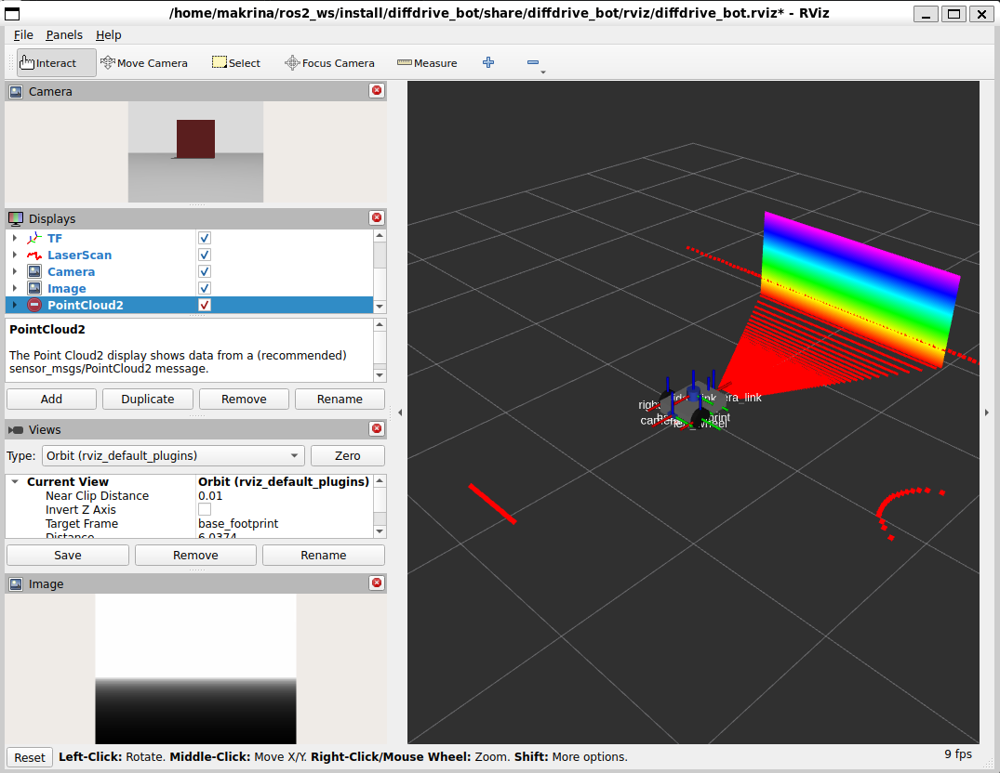
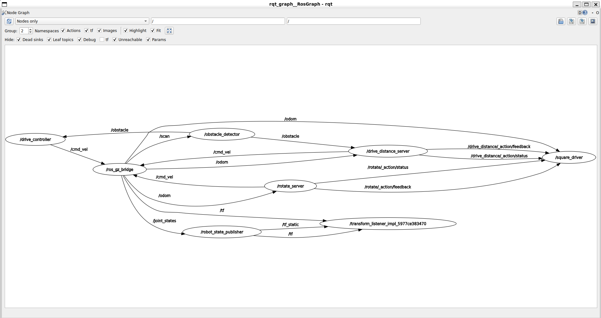

# Lab 1 Exercise: Programming diffdrive_bot

Introduction to Robotics and Intelligent Systems, 2026.

This repository holds my solution to the Lab 1 exercise. It contains four ROS 2 packages:

| Package | Build type | Contents |
|---------|------------|----------|
| `diffdrive_bot` | `ament_cmake` | The lab robot, extended with a depth camera and an IMU (Step 1) |
| `lab_interfaces` | `ament_cmake` | The lab's message, service and action types, unchanged |
| `my_robot_interfaces` | `ament_cmake` | My types: `msg/RobotStatus`, `srv/SetTurnSpeed`, `action/Rotate` |
| `my_robot_nodes` | `ament_python` | My nodes `turn_away`, `rotate_server` and `square_driver`, and `launch/square.launch.py` |

## Environment

I did the exercise with **ROS 2 Jazzy** on Ubuntu 24.04 (WSL2 on Windows 11), not Humble.
Jazzy's default Gazebo is Harmonic, the same Gazebo the course uses, so the packages need no
code changes. The only differences from the course instructions are:

- `source /opt/ros/jazzy/setup.bash` instead of `/opt/ros/humble/setup.bash`
- the Gazebo packages come from the ROS repository, not the OSRF one:

```bash
sudo apt install ros-jazzy-ros-gz ros-jazzy-xacro ros-jazzy-joint-state-publisher-gui ros-jazzy-teleop-twist-keyboard
```

## Build

Clone the repository into the `src` folder of a workspace and build:

```bash
source /opt/ros/jazzy/setup.bash
mkdir -p ~/ros2_ws/src && cd ~/ros2_ws/src
git clone https://github.com/Efrata-Habte/Robotics-Lab.git lab1_exercise
cd ~/ros2_ws
colcon build --symlink-install
source install/setup.bash
```

If the course repository `intro_robotics_intelligent_systems_labs` is in the same workspace, put a
`COLCON_IGNORE` file in its `lab_01` folder first, because colcon refuses to build two packages with
the same name.

Every new terminal needs `source ~/ros2_ws/install/setup.bash`.

## Running each step

Steps 2 to 6 need the robot running in a first terminal:

```bash
ros2 launch diffdrive_bot control.launch.py
```

Run the commands of each step in a second and third terminal. Only one node should drive the robot
at a time, so stop the node of one step before starting the next.

### Step 1: Depth camera and IMU

The depth camera is on the back of the chassis, looking backwards; the IMU is at the centre of the
chassis.

```bash
ros2 launch diffdrive_bot display.launch.py                 # model only, frames depth_camera_link and imu_link
ros2 run tf2_ros tf2_echo base_link depth_camera_link       # [-0.215, 0, 0], yaw 180 deg
ros2 launch diffdrive_bot gazebo.launch.py                  # simulation
ros2 topic hz /imu --use-sim-time                           # about 50 Hz
ros2 topic echo /imu --field linear_acceleration            # z about 9.8 at rest
```

In RViz, add an Image display for `/depth_camera/image` and a PointCloud2 display for
`/depth_camera/points`. The robot starts with the wall behind it, so the depth camera sees the wall:



### Steps 2 to 5: turn_away

`turn_away` drives forward at `forward_speed` and turns on the spot at `turn_speed`, away from the
obstacle, when `/obstacle` reports it too close. It publishes a `RobotStatus` on `/robot_status` for
every `/obstacle` message. It starts switched off.

```bash
ros2 run my_robot_nodes turn_away --ros-args -p use_sim_time:=true
```

```bash
ros2 service call /turn_away_enable std_srvs/srv/SetBool "{data: true}"    # Step 5: switch on
ros2 topic echo /robot_status                                              # Step 4: forward / turning
ros2 param set /turn_away forward_speed 0.4                                # Step 3: takes effect at once
ros2 service call /set_turn_speed my_robot_interfaces/srv/SetTurnSpeed "{turn_speed: 1.0}"   # accepted
ros2 service call /set_turn_speed my_robot_interfaces/srv/SetTurnSpeed "{turn_speed: 3.0}"   # rejected, above max_turn_speed
ros2 service call /turn_away_enable std_srvs/srv/SetBool "{data: false}"   # robot stops, state "stopped"
```

In `rqt_graph`, `/turn_away` sits between `/obstacle` and `/cmd_vel` (Step 2).

### Step 6: rotate_server

`rotate_server` serves `/rotate`. It adds up the change in yaw between consecutive `/odom` messages,
so the jump of the yaw from pi to -pi does not matter.

```bash
ros2 run my_robot_nodes rotate_server --ros-args -p use_sim_time:=true
```

```bash
ros2 action send_goal --feedback /rotate my_robot_interfaces/action/Rotate "{angle: 1.57}"   # quarter turn left
ros2 run tf2_ros tf2_echo odom base_link                                                    # new heading
ros2 action send_goal /rotate my_robot_interfaces/action/Rotate "{angle: 0.0}"              # rejected
```

Pressing Ctrl+C during a goal cancels it and the robot stops.

### Step 7: square_driver and square.launch.py

`square_driver` sends four times a `/drive_distance` goal of `side_length` and a `/rotate` goal of a
quarter turn left, each after the one before has finished. If a goal does not succeed it logs the
side and stops. The launch file starts the robot, `rotate_server` and `square_driver` with one
command (stop `control.launch.py` first):

```bash
ros2 launch my_robot_nodes square.launch.py side_length:=0.8
```

The robot drives the square and logs `Square complete`. In my test it ended 3 cm from its starting
point. The graph while it runs:



## What did not work, and why

**The depth camera ignored `camera_info_topic`.** I set `<camera_info_topic>` to
`/depth_camera/camera_info` as the exercise asks, but Gazebo still published the depth camera's
camera info on `/camera_info` (`gz topic -i -t /camera_info` showed the publisher, with a 320 x 240
image). I think the depth camera sensor in the Gazebo Harmonic version shipped with Jazzy does not read
that setting, while the normal camera does: the front camera's info does arrive on
`/camera/camera_info`. I kept the setting in the URDF and bridged from Gazebo's `/camera_info` to
ROS 2's `/depth_camera/camera_info` in `config/bridge.yaml`, so the ROS 2 topic has the expected name.

**`/imu` showed less than 50 Hz.** `ros2 topic hz /imu` showed about 24 Hz with Gazebo and RViz open,
and about 40 Hz without the Gazebo window. Gazebo ran at roughly half of real time on my WSL2
machine, which renders without a GPU, and `ros2 topic hz` measures in wall-clock time. With
`--use-sim-time` it measures in simulation time and shows 50 Hz, so the sensor itself is configured
correctly.

**The PointCloud2 display showed an error icon in RViz** even though it drew the point cloud
correctly, as in the Step 1 screenshot. I think it reported messages that arrived before the
transform to `depth_camera_link` was available while the simulation was starting.

**turn_away switches between turning and forward near an obstacle.** The obstacle detector only looks
at a sector of plus or minus 0.35 rad in front of the robot. As soon as the edge of the box leaves
that sector the robot drives forward again, sees the edge again and turns a little more, so it
passes the box in a few short turns rather than one.

**rotate_server turns slightly too far.** A quarter-turn goal ended at about 1.59 rad, and the robot's
heading at about 1.62 rad. Odometry arrives every 50 ms, so the server notices the goal angle up to
one message late, and the robot keeps turning briefly after the stop command because the drive
plugin limits its deceleration. Over the four turns of a square the errors stay small: the robot
ended 3 cm from its start.

**Goals sent too early are rejected.** Both action servers reject goals until they have received
odometry, and Gazebo takes several seconds to start. So that `square.launch.py` works with one
command, `square_driver` waits for both action servers and for the first `/odom` message before it
sends the first goal.
